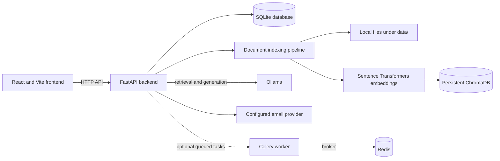

# Continuum — Knowledge Continuity Platform

Continuum is a knowledge continuity platform for capturing, organizing, and transferring company knowledge. It helps teams understand where critical knowledge lives, find relevant documentation, assess employee and project knowledge risk, and prepare handovers when responsibilities change.

## 1. Problem Statement

Important organizational knowledge is often spread across employee-owned folders, project documents, and individual experience. When an employee leaves or changes roles, that knowledge can become difficult to find or transfer. Teams may lack a clear view of who owns key expertise, which projects depend on it, and what a successor needs to know.

## 2. Solution

Continuum provides a shared workspace to manage employees, skills, projects, and local knowledge connections. It indexes supported documents for semantic search, presents knowledge and continuity risk views, and helps create structured handover packages that can be delivered through a configured email provider.

Knowledge folders are selected explicitly from the project's `data/` directory. The application indexes supported files in place; it does not create, move, or rename the source folders. Authentication and application records use the local backend database.

## 3. Tech Stack

- **Frontend:** React 19, TypeScript, Vite, Tailwind CSS, Lucide React, and Motion.
- **Backend:** Python, FastAPI, Pydantic Settings, and SQLAlchemy.
- **Relational storage:** SQLite through SQLAlchemy's async interface.
- **Semantic search:** Sentence Transformers (`all-MiniLM-L6-v2`) embeddings and ChromaDB.
- **Language model:** Ollama, configured by `OLLAMA_BASE_URL` and `OLLAMA_MODEL`.
- **Email:** Console, SMTP, or Resend provider configuration.
- **Optional job infrastructure:** Celery with Redis as its broker.

## 4. Architecture



The frontend is in `frontend/` and calls the versioned API at `/api/v1`. The FastAPI application owns authentication, business rules, and persistence. SQLite stores operational records; ChromaDB stores document vectors; original knowledge files remain in `data/`. Ollama is used for local language-model operations. Redis and Celery are optional infrastructure for queued work.

## 5. Feasibility and Viability

The core platform is feasible to run locally with Node.js, Python, and the configured local database and AI components. SQLite avoids requiring a separate relational database server, and ChromaDB can run as an embedded persistent store. The supported local-folder workflow also avoids requiring Drive or Notion OAuth credentials.

Operational viability depends on maintaining the local database, Chroma index, and source files together, and on having adequate machine resources for embedding and language-model workloads. Email delivery beyond local development requires a correctly configured SMTP service or a verified sender with a provider such as Resend. Risk indicators should be treated as decision support and reviewed against real organizational context; they are only as reliable as the employee, project, and knowledge data supplied.

## 6. Research References

1. Galan, N. (2023). [Knowledge loss induced by organizational member turnover: a review of empirical literature, synthesis and future research directions (Part I)](https://doi.org/10.1108/TLO-09-2022-0107). *The Learning Organization, 30*(2), 117–136.
2. Lewis, P. et al. (2020). [Retrieval-Augmented Generation for Knowledge-Intensive NLP Tasks](https://proceedings.neurips.cc/paper/2020/hash/6b493230205f780e1bc26945df7481e5-Abstract.html). *Advances in Neural Information Processing Systems 33*.
3. Reimers, N., & Gurevych, I. (2019). [Sentence-BERT: Sentence Embeddings using Siamese BERT-Networks](https://aclanthology.org/D19-1410/). *Proceedings of EMNLP-IJCNLP 2019*.

## Run the frontend

Prerequisite: Node.js.

```bash
cd frontend
npm install
npm run dev
```

Vite serves the app at `http://localhost:3000`. Frontend environment values are documented in [`frontend/.env.example`](frontend/.env.example); put them in the repository-root `.env` file, which Vite loads for this setup.

## Run the backend

Follow the backend setup guide in [`backend/README.md`](backend/README.md). It covers local setup, configuration, and optional Docker Compose deployment.
